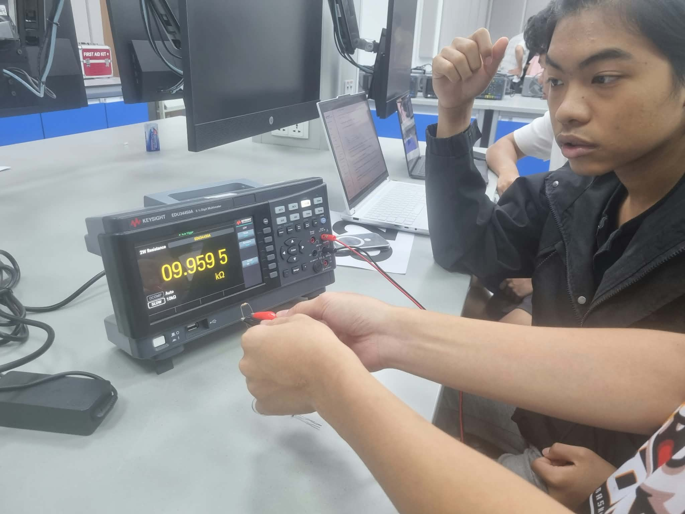
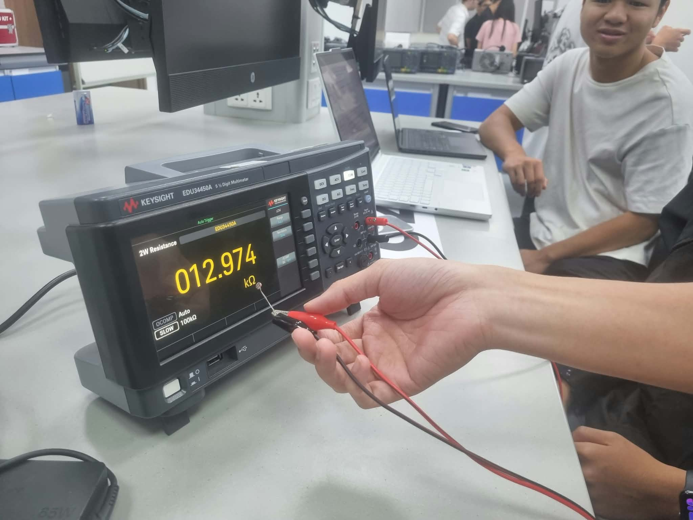
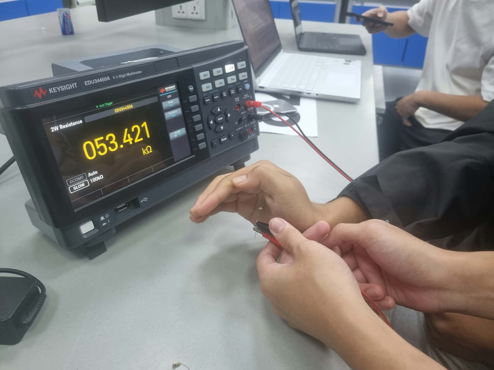
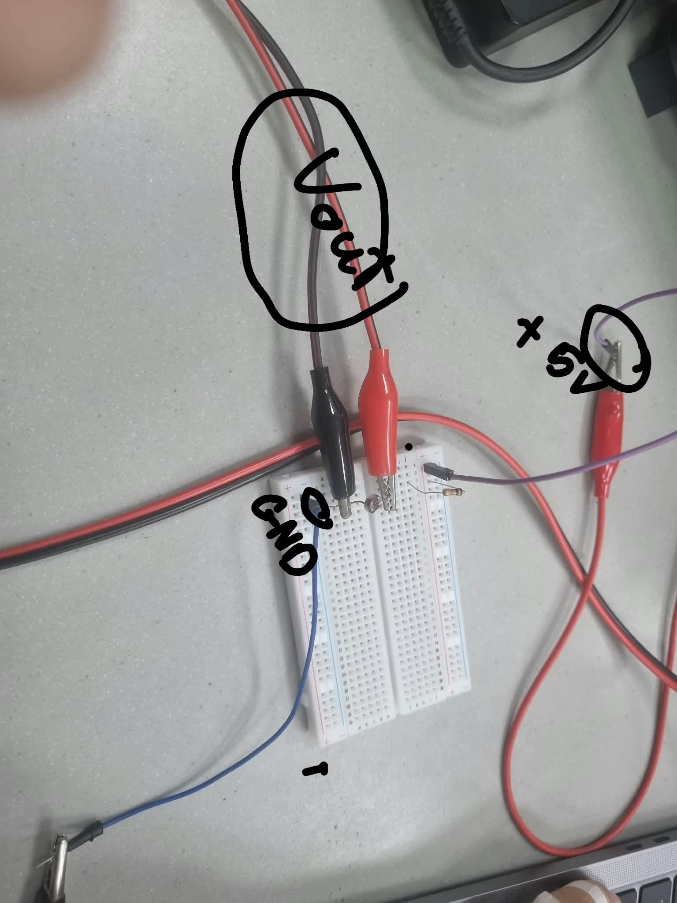
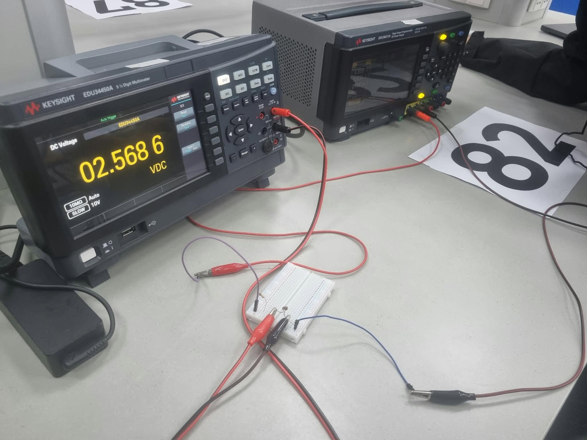
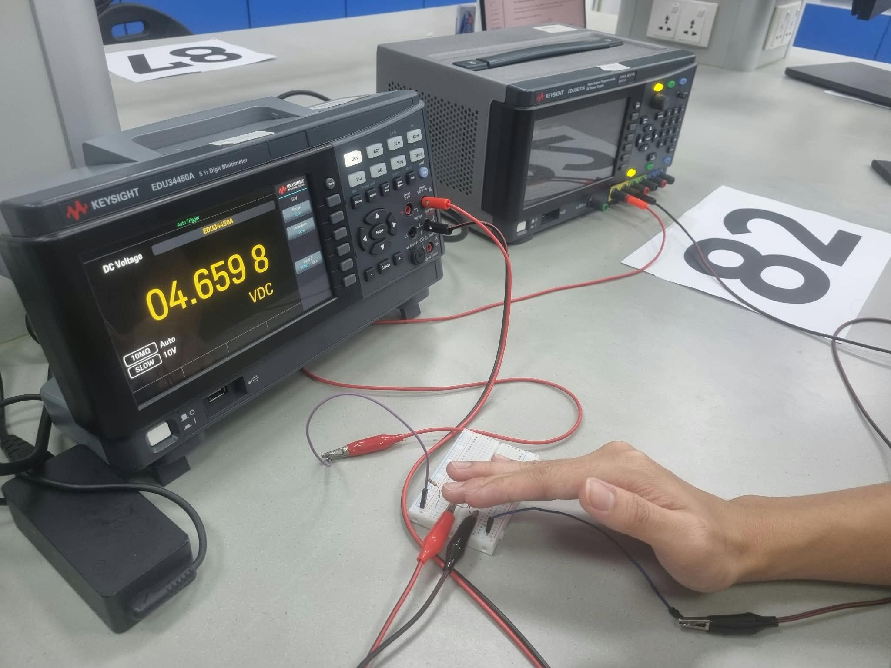

# Lab 1 — SENSE: Giving a System Senses

- Team name: Team 9
- GitHub usernames: caocchinh (CS), DUCDUCDUC38 (EE), bfhvn (DS), phamvuminh080908 (EE)

Report progress: Tasks 1–5 documented; remaining sections pending.

## Part 1: Meet the tools and the sensor

### Task 1. Measure a fixed resistor

We measured the fixed resistor using the multimeter in two-wire resistance mode, with one clip lead connected to each end of the resistor. The resistor was disconnected from the circuit during the measurement.

- **Nominal resistance:** 10 kΩ.
- **Marked tolerance:** ±5%.
- **Measured resistance:** 9.9595 kΩ.

The ±5% tolerance allows a variation of `10 × 0.05 = 0.5 kΩ` from the nominal value. Therefore, the acceptable resistance range is **9.5–10.5 kΩ**.

Our measured value is `10 − 9.9595 = 0.0405 kΩ` below the nominal value, a difference of `(0.0405 / 10) × 100% = 0.405%`. Since 9.9595 kΩ lies within the acceptable range, the measurement is consistent with the resistor's marked tolerance. A resistor does not need to measure exactly 10 kΩ to meet this specification. We will use the measured value of 9.9595 kΩ in the voltage-divider calculations.

_Photo 1. The multimeter shows 9.9595 kΩ across the disconnected 10 kΩ resistor, within its ±5% tolerance range._

### Task 2. Investigate the photoresistor

We connected the multimeter leads to the disconnected LDR and measured its resistance under normal room lighting, then with a hand shading its light-sensitive surface. To repeat the comparison, keep the sensor position and room lighting the same and change only the hand coverage.

| Condition | Method                                     | Measured resistance (kΩ) |
| --------- | ------------------------------------------ | ------------------------ |
| Exposed   | Uncovered under normal room lighting       | 12.974                   |
| Covered   | Light-sensitive surface shaded with a hand | 53.421                   |

Covering the LDR increased its resistance from 12.974 kΩ to 53.421 kΩ, approximately 4.12 times the exposed value. This shows the expected response: less light gives a higher resistance, while more light gives a lower resistance.

We predict that **covering the LDR will increase Vout**. Photons from light give electrons in the LDR energy to carry current. Covering it blocks some of these photons, so fewer electrons can carry current and its resistance increases. In our circuit, this means a larger voltage across the LDR, so Vout rises.

The covered reading depends on how much light the hand blocks. Hand coverage reduces the light reaching the sensor but does not establish complete darkness.

_Photo 2. The exposed LDR measures 12.974 kΩ under normal room lighting._

_Photo 3. Shading the LDR with a hand increases its measured resistance to 53.421 kΩ._

## Part 2: Build the sensor circuit

### Task 3. Set up the power supply

- Supply setting: 5 V; current limit: 0.01 A (10 mA).
- Supply voltage, Vs: 5 V.

### Task 4. Build a voltage divider

We connected the fixed resistor and LDR in series on the breadboard to build a voltage divider.

_Photo 4. The purple wire supplies +5 V to the fixed resistor. The red measurement clip connects to Vout, where the fixed resistor meets the LDR. The other side of the LDR connects to GND through the blue wire. The black measurement clip connects to the same GND reference._

- **Corrections before powering:** No wiring corrections were needed.

### Task 5. Measure the output voltage

We set the multimeter to DC voltage and connected the red lead to Vout and the black lead to GND. We measured the output with the LDR exposed to room lighting, then covered with a hand.

We used the measured fixed resistance, **Rs = 9.9595 kΩ**, the LDR resistances from Task 2 and the supply voltage, **Vs = 5 V**, from Task 3.

Using `Vout = Vs × Rphoto / (Rs + Rphoto)`, the exposed calculation is:

`Vout = 5 × 12.974 / (9.9595 + 12.974) = 2.8286 V`

| Condition and method | LDR resistance from Task 2 (kΩ) | Calculated output (V) | Measured output (V) |
| --- | --- | --- | --- |
| Exposed to room lighting | 12.974 | 2.8286 | 2.5686 |
| Covered with a hand | 53.421 | 4.2143 | 4.6598 |

Covering the LDR increased Vout from **2.5686 V to 4.6598 V**, matching our prediction. Blocking light increases the LDR's resistance, which raises the output voltage in this circuit.

The measured output was lower than calculated when exposed and higher when covered. Room lighting or hand coverage may have differed from Task 2, changing the LDR's resistance between measurements.

_Photo 5. With the LDR exposed to room lighting, the output voltage is 2.5686 V._

_Photo 6. Covering the LDR with a hand increases the output voltage to 4.6598 V._

## Part 3: Observe the signal over time

### Task 6. Connect the oscilloscope

- Probe tip and ground-reference connections:
- Probe attenuation and matching oscilloscope setting:

### Task 7. Observe the live signal

**Insert your photo here:** oscilloscope capture showing the signal change, with voltage and time scales visible. Add a caption describing what the trace shows. If you use a short recording instead, insert an accessible recording link here and explain the same result.

- Voltage scale and time scale:
- What changed when we covered/uncovered the LDR:
- Comparison with the multimeter readings and what the time trace reveals:

## Project connection

What quantity might our project measure? What decision would it support? What assumption needs testing? Our project need not use an LDR.

## Contributions

Add one row per member. Include physical, paired, analytical and documentation work as relevant. Each member commits meaningful work using their own account; commit counts are not graded.

| GitHub username  | Work completed and result I can explain | Evidence or report section |
| ---------------- | --------------------------------------- | -------------------------- |
| caocchinh        |                                         |                            |
| DUCDUCDUC38      |                                         |                            |
| bfhvn            |                                         |                            |
| phamvuminh080908 |                                         |                            |

## Sources and AI use

Cite sources. Disclose permitted AI tools, purpose, relevant prompts/output used and how we checked or corrected it, or state that no AI was used. Keep private information out of the report and prompts.

Before submitting, check that your measurement photos appear inside the report and follow the handout's checklist. Submit your ordinary Labs repository link and the latest full commit SHA once per team in Canvas before the deadline. The report is `labs/lab-01/README.md`; no permanent link is required. Do not insert the SHA into this report. If you revise the work, update the SHA in Canvas only when resubmission is allowed.
