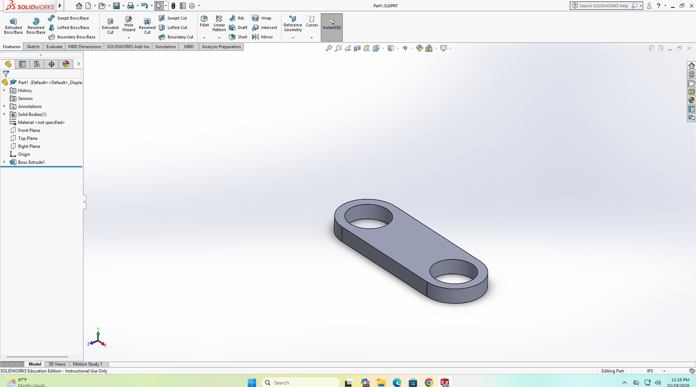

# Lab 2 – SHAPE: Explore and Design

- Team name: Team 9
- Members' GitHub usernames: caocchinh, DUCDUCDUC38, bfhvn, phamvuminh080908

## Classroom record

### 1. Explore CAD and the printing process

Answer each question in one or two sentences and identify the source you used.

1. **What does the CAD application do, what does the slicer do, and what does the printer do?**\
   **Answer:** CAD software creates or edits a dimensioned 3D model, the slicer uses the model and print settings to generate instructions for the printer, and the printer follows those instructions to build the part layer by layer.\
   **Source:** [Prusa, “3D Printing 101”](https://www.prusa3d.com/p/3d-printing/3d-printing-101/)

2. **For an initial sensor bracket, what advantage or limitation of PLA and PETG would affect your material choice?**\
   **Answer:** PLA is easy to print and good for detailed prototypes, but it is brittle and has low heat resistance. PETG is tougher and more resistant to heat and moisture, so it is a better candidate for a durable sensor bracket, although its overhangs and supports can be harder to manage.\
   **Source:** Prusa’s [PLA](https://help.prusa3d.com/article/pla_2062) and [PETG](https://help.prusa3d.com/article/petg_2059) guides

3. **Which dimensions would you check to confirm that a part fits its component and the printer's build space? Why should you check an imported STL's size and units?**\
   **Answer:** Check the sensor seat or body dimensions, mounting-hole diameters and spacing, clip gap, and the part’s overall X/Y/Z size against the printer’s usable build volume. STL files do not store units, so verify the imported dimensions and intended scale (for example, millimeters) in the slicer to avoid printing the part at the wrong size.\
   **Source:** [Lab 2 handout](https://vinuni-cecs1011.github.io/labs/lab-02.html) and Prusa’s [First print with PrusaSlicer](https://help.prusa3d.com/article/first-print-with-prusaslicer-2-9_1753)

4. **Which file would you keep for future dimension changes, and when would STEP be useful?**\
   **Answer:** Keep the native CAD file, such as `.SLDPRT`, because it can retain editable sketches, dimensions, and features for later changes. STEP (`.step` or `.stp`) is useful for transferring solid or surface geometry between CAD applications, but usually does not preserve the original sketch and feature history.\
   **Source:** [Lab 2 handout](https://vinuni-cecs1011.github.io/labs/lab-02.html)

5. **How could print orientation affect the need for temporary supports? Describe one example.**\
   **Answer:** Orientation changes whether each new layer rests on the bed or on a previously printed layer; steep overhangs or sections starting in midair may need temporary supports. For example, an L-bracket with a projecting arm may need supports when printed upright, while rotating it to rest on a broad side can reduce the unsupported span.\
   **Source:** Prusa’s [First print with PrusaSlicer](https://help.prusa3d.com/article/first-print-with-prusaslicer-2-9_1753)

### 2. Choose a design for the final project

- **Project use (assumption):** Our project aims to monitor fridge conditions to reduce food spoilage ([onboarding note](../../onboarding/caocchinh.md)). The holder would position the sensor in open air and keep its readout visible. The clip gap must fit the shelf; sensor and shelf dimensions are not measured yet.
- **Reference:** [Humidity & Temperature Sensor Holder](https://makerworld.com/en/models/1137074-humidity-temperature-sensor-holder?from=search#profileId-1138555) by **StefB**. It holds Bambu Lab's B-XF001 sensor and is described as support-free. The listing has one `.3mf` print profile and no native CAD/STEP file. Its Standard Digital File License restricts remixes, redistribution, and commercial use without permission.
- **Material/orientation:** Material is **not stated** (“Default, all plastics”). We propose PETG for a tougher, moisture-resistant clip ([Prusa guide](https://help.prusa3d.com/category/material-guide_220)). Print the broad mounting face on the bed, sensor seat facing up.
- **Adaptation:** Model a new open-sided shelf clip for our measured sensor and shelf. Keep the sensor exposed to airflow and the display accessible; do not remix the reference geometry.

### 3. Practise SolidWorks individually

- Tutorial source: [SolidWorks 2020 Tutorial: Exercise 1, learn from Home!](https://youtu.be/RdXIB7IHMT4?t=98) (stopped at 1:38)
- Stage reached: first Boss-Extrude (`Boss-Extrude1`), forming the link with two holes
- Representative native file: [Team09_Lab02_practice.sldprt](Team09_Lab02_practice.sldprt)

_Team 9's representative practice screenshot._

### 4. Begin the team design

- State your part's purpose and one measurable requirement, with a reason. Identify the source of its dimensions and label assumptions.
- Insert **one dimensioned starting sketch**, using a line such as `` with your uploaded filename.
- Link the initial CAD document and describe the sketch or first feature created in class. If the same file is updated later, its earlier version remains in Git history.
- State which CAD software you will use after class and what remains to be completed. Record any unresolved access or modelling difficulty.

## Design completed after class

- CAD application/version:
- State whether you created a new model, adapted a reference or reconstructed a limited feature. Credit any reused source and identify the scope.

| Dimension/check            | Intended value and reason | CAD result and checking method |
| -------------------------- | ------------------------- | ------------------------------ |
| Critical dimension         |                           |                                |
| Another relevant dimension |                           |                                |

Insert **one final-model image** showing the checked dimensions, using a line such as ``. Retain the starting sketch in the classroom record. There should be **three images in total**, including the practice screenshot.

- Explain what you created or changed, any revision and any remaining limitation.
- Link the final native CAD document and STL. State the export units or settings and whether you reopened the STL and checked its size.
- Propose one physical test that would check the part's fit or function.

## Contributions

Use one row per member and update it as work develops. Each member should contribute using their own GitHub account and explain their individual practice and team design work.

| GitHub username  | Individual practice operation I can explain                                                                                                                                                                                                                                                                                                                                     | Team design contribution and result I can explain |
| ---------------- | ------------------------------------------------------------------------------------------------------------------------------------------------------------------------------------------------------------------------------------------------------------------------------------------------------------------------------------------------------------------------------- | ------------------------------------------------- |
| caocchinh        | I learned to set up a SolidWorks part, sketch on default planes or existing faces, and use Smart Dimension and Extruded Boss/Base to create accurately sized solids. I also practiced editing features, making blind or through-all cuts, adding fillets, and using Revolved Boss/Base to create circular geometry.                                                             |                                                   |
| DUCDUCDUC38      | I created 2D sketches on selected faces of a 3D part and used the Extruded Cut feature to remove material and shape the model. I learned how to control the cut direction and depth to achieve the desired result. Finally, I refined the part by adjusting the cut parameters to create precise openings, slots, and other features.                                           |                                                   |
| bfhvn            | I set up a part, created 2D sketches on planes and faces, and transformed them into 3D geometry using Extruded Boss/Base. I mastered using Smart Dimension to define shapes and Extruded Cut to remove material. Finally, I utilized the Edit Feature tool to adjust the depth of my cuts with precision.                                                                       |                                                   |
| phamvuminh080908 | I created 2D sketch profiles and defined paths to build more complex 3D shapes using the Sweep feature. I learned how to guide a profile along a selected trajectory to form curved and elongated structures. Finally, I applied Sweep to model features such as pipes and tubes, gaining a better understanding of how profiles and paths work together to create 3D geometry. |                                                   |

## Sources and AI use

- Sources: [SolidWorks 2020 tutorial](https://youtu.be/RdXIB7IHMT4?t=98), [Prusa 3D Printing 101](https://www.prusa3d.com/p/3d-printing/3d-printing-101/), Prusa’s [PLA](https://help.prusa3d.com/article/pla_2062), [PETG](https://help.prusa3d.com/article/petg_2059), and [PrusaSlicer](https://help.prusa3d.com/article/first-print-with-prusaslicer-2-9_1753) guides, plus [MakerWorld](https://makerworld.com/en/models/1137074-humidity-temperature-sensor-holder?from=search#profileId-1138555) and [Bambu XF001](https://us.store.bambulab.com/products/circular-embedded-electronic-digital-thermometer-1pcs-xf001).

Before submission, check the files and links against the [Lab 2 handout](https://vinuni-cecs1011.github.io/labs/lab-02.html#save-and-submit). Include your team name, ordinary repository link, report path and full SHA in the Canvas record. Copy the latest full repository commit SHA after saving everything; keep it out of this report.
