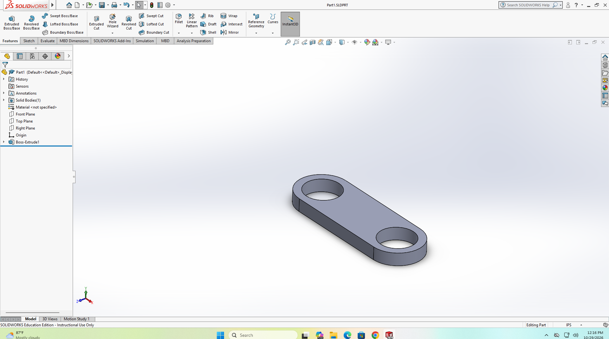
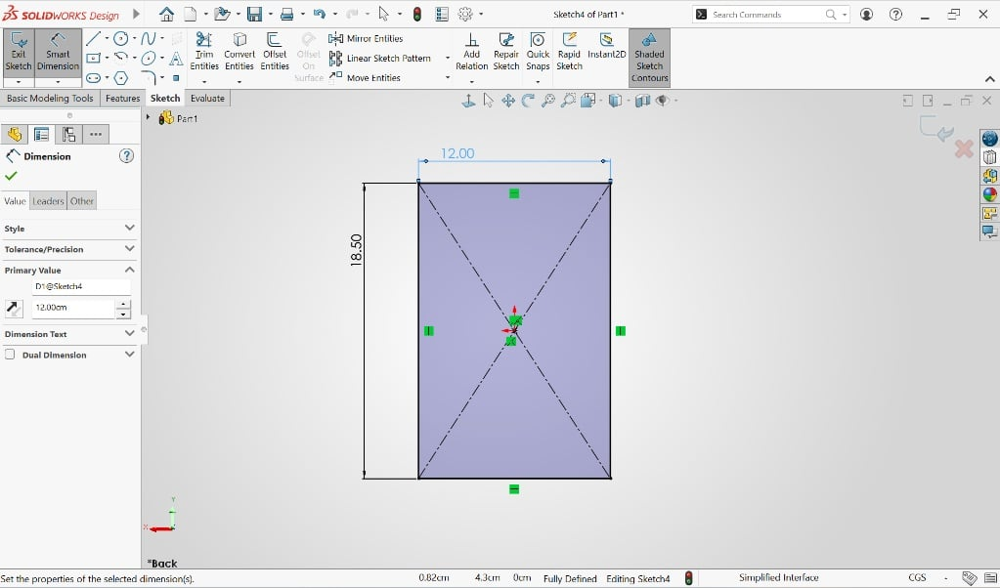
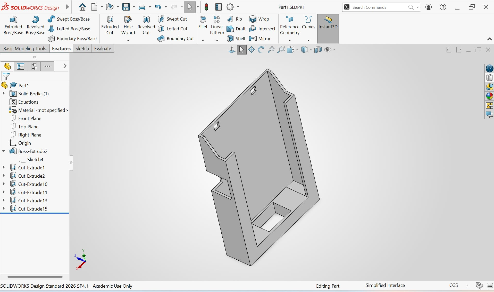

# Lab 2 – SHAPE: Explore and Design

- Team name: Team 9
- Members' GitHub usernames: caocchinh, DUCDUCDUC38, bfhvn, phamvuminh080908

## Classroom record

### 1. Explore CAD and the printing process

Answer each question in one or two sentences and identify the source you used.

1. **What does the CAD application do, what does the slicer do, and what does the printer do?**\
   **Answer:** CAD software creates or edits a dimensioned 3D model, the slicer uses the model and print settings to generate instructions for the printer, and the printer follows those instructions to build the part layer by layer.\
   **Source:** [Prusa, “3D Printing 101”](https://www.prusa3d.com/p/3d-printing/3d-printing-101/)

2. **For an initial sensor bracket, what advantage or limitation of PLA and PETG would affect your material choice?**\
   **Answer:** PLA is easy to print and good for detailed prototypes, but it is brittle and has low heat resistance. PETG is tougher and more resistant to heat and moisture, so it is a better candidate for a durable sensor bracket, although its overhangs and supports can be harder to manage.\
   **Source:** Prusa’s [PLA](https://help.prusa3d.com/article/pla_2062) and [PETG](https://help.prusa3d.com/article/petg_2059) guides

3. **Which dimensions would you check to confirm that a part fits its component and the printer's build space? Why should you check an imported STL's size and units?**\
   **Answer:** Check the sensor seat or body dimensions, mounting-hole diameters and spacing, clip gap, and the part’s overall X/Y/Z size against the printer’s usable build volume. STL files do not store units, so verify the imported dimensions and intended scale (for example, millimeters) in the slicer to avoid printing the part at the wrong size.\
   **Source:** [Lab 2 handout](https://vinuni-cecs1011.github.io/labs/lab-02.html) and Prusa’s [First print with PrusaSlicer](https://help.prusa3d.com/article/first-print-with-prusaslicer-2-9_1753)

4. **Which file would you keep for future dimension changes, and when would STEP be useful?**\
   **Answer:** Keep the native CAD file, such as `.SLDPRT`, because it can retain editable sketches, dimensions, and features for later changes. STEP (`.step` or `.stp`) is useful for transferring solid or surface geometry between CAD applications, but usually does not preserve the original sketch and feature history.\
   **Source:** [Lab 2 handout](https://vinuni-cecs1011.github.io/labs/lab-02.html)

5. **How could print orientation affect the need for temporary supports? Describe one example.**\
   **Answer:** Orientation changes whether each new layer rests on the bed or on a previously printed layer. Steep overhangs or sections starting in midair may need temporary supports. For example, an L-bracket with a projecting arm may need supports when printed upright, while rotating it to rest on a broad side can reduce the unsupported span.\
   **Source:** Prusa’s [First print with PrusaSlicer](https://help.prusa3d.com/article/first-print-with-prusaslicer-2-9_1753)

### 2. Choose a design for the final project

- **Project use:** The holder positions the fridge sensor near a rack, keeps its display visible, and exposes the sensor to air.
- **Reference:** [Hanging Holder for SwitchBot Meter Plus](https://makerworld.com/en/models/3427659-hanging-holder-for-switchbot-meter-plus?from=search#profileId-3907115) by **yamato**. It holds a SwitchBot Meter Plus and hangs from two S-hooks.
- **Reference license and files:** License not recorded. The team files are SolidWorks and STL files.
- **Material and orientation:** We selected PETG for moisture resistance. The broad back face sits on the print bed.
- **Adaptation:** We created an upright sensor holder with a back panel, side supports, a lower support, and cutouts.

### 3. Practise SolidWorks individually

- Tutorial source: [SolidWorks 2020 Tutorial: Exercise 1, learn from Home!](https://youtu.be/RdXIB7IHMT4?t=98) (stopped at 1:38)
- Stage reached: first Boss-Extrude (`Boss-Extrude1`), forming the link with two holes
- Representative native file: [Team09_Lab02_practice.sldprt](Team09_Lab02_practice.sldprt)

_Team 9's representative practice screenshot._

### 4. Begin the team design

- **Purpose and requirement:** The holder supports the fridge sensor, keeps its display visible, and exposes it to air. The starting support profile measures 12.00 cm × 18.50 cm in the SolidWorks CGS unit system.
- **Starting sketch:** The starting sketch is a fully defined 12.00 cm × 18.50 cm rectangle.

_Team 9's fully defined SolidWorks starting sketch._

- **Initial CAD document:** [Team09-design.SLDPRT](Team09-design.SLDPRT). The model uses sketches, extrusions, and cut features.
- **Software:** SolidWorks Design Standard 2026 SP4.1.

## Design completed after class

- **CAD application/version:** SolidWorks Design Standard 2026 SP4.1.
- **Model scope and credit:** We created a new upright sensor holder inspired by the [MakerWorld hanging-holder reference](https://makerworld.com/en/models/3427659-hanging-holder-for-switchbot-meter-plus?from=search#profileId-3907115) by yamato.
- **Feature summary:** The model has a back panel, side supports, a lower support, slots, and a rectangular opening.

| Dimension/check         | Intended value and reason                                                                                        | CAD result and checking method                                                                                                                          |
| ----------------------- | ---------------------------------------------------------------------------------------------------------------- | ------------------------------------------------------------------------------------------------------------------------------------------------------- |
| Starting-profile width  | 12.00 cm. It sets the width of the starting support profile.  | Checked with Smart Dimension in the starting sketch. |
| Starting-profile height | 18.50 cm. It sets the height of the starting support profile. | Checked with Smart Dimension in the starting sketch. |

_Team 9's final SolidWorks model._

- **Changes:** We extruded the starting profile and used cuts to form the upright holder, support surfaces, slots, and opening.
- **Final files and export check:** [Team09-design.SLDPRT](Team09-design.SLDPRT) and [Team09-design.STL](Team09-design.STL). The STL was reopened and checked in SolidWorks. Its export metadata identifies the object as `Team09-design.stl` and reports dimensions of 120 × 34.5794 × 185 mm, a volume of 110603 mm³, and 176 triangles.
- **Proposed physical test:** Print the holder, insert the sensor, and check that it sits securely with the display visible.

## Contributions

Use one row per member and update it as work develops. Each member should contribute using their own GitHub account and explain their individual practice and team design work.

| GitHub username  | Individual practice operation I can explain                                                                                                                                                                                                                                                                                                                                                                                                                    | Team design contribution and result I can explain                                                                                                                           |
| ---------------- | -------------------------------------------------------------------------------------------------------------------------------------------------------------------------------------------------------------------------------------------------------------------------------------------------------------------------------------------------------------------------------------------------------------------------------------------------------------- | --------------------------------------------------------------------------------------------------------------------------------------------------------------------------- |
| caocchinh        | I followed the new SolidWorks 2020 Exercise 1 tutorial through 1:38 and reached the first Boss-Extrude (`Boss-Extrude1`), forming a link-shaped base with two holes.                                                                                                                                                                                                                                                                                           | I built the 3D model in SolidWorks, drew all the base sketches, added dimensions, and ran the extrusions and cuts. I can explain the sketch constraints and feature tree.   |
| DUCDUCDUC38      | I followed the new SolidWorks 2020 Exercise 1 tutorial through 4:14, forming a link-shaped base with two holes and a 2 upper part of body with 2 holes                                                                                                                                                                                                                                                                                                         |   I setup real-world model for team to follow and finish final work dimension. I can explain the part's dimension and model size in 3d printing                                                                                                                                                                          |
| bfhvn            | I set up a part, created 2D sketches on planes and faces, and transformed them into 3D geometry using Extruded Boss/Base. I mastered using Smart Dimension to define shapes and Extruded Cut to remove material. Finally, I utilized the Edit Feature tool to adjust the depth of my cuts with precision.                                                                                                                                                      |   I collaborated with the team to design and refine the final sensor holder model, contributing to the creation of mounting slots, support structures, and cutouts to fit the SwitchBot Meter Plus securely while ensuring airflow and display visibility. I can explain the feature modeling steps, cut operations, and how the model dimensions match the requirements.                                                                                                                                                                          |
| phamvuminh080908 |I practised creating a 3D mechanical part in SolidWorks using 2D sketches and the Boss-Extrude feature. I learned how to apply dimensions, create rounded profiles and holes, and convert sketches into 3D geometry based on an engineering drawing.| Handled exporting the finished SolidWorks model file to STL for 3D printing and checked for solid body geometry errors. I can explain the file export and model prep steps. |

## Sources and AI use

- Sources: [SolidWorks 2020 tutorial](https://youtu.be/RdXIB7IHMT4?t=98), [Prusa 3D Printing 101](https://www.prusa3d.com/p/3d-printing/3d-printing-101/), Prusa’s [PLA](https://help.prusa3d.com/article/pla_2062), [PETG](https://help.prusa3d.com/article/petg_2059), and [PrusaSlicer](https://help.prusa3d.com/article/first-print-with-prusaslicer-2-9_1753) guides, plus the [MakerWorld hanging holder reference](https://makerworld.com/en/models/3427659-hanging-holder-for-switchbot-meter-plus?from=search#profileId-3907115).
- AI use: AI helped organize and rephrase the report using the team's sources and supplied CAD files.

Before submission, check the files and links against the [Lab 2 handout](https://vinuni-cecs1011.github.io/labs/lab-02.html#save-and-submit). Include your team name, ordinary repository link, report path and full SHA in the Canvas record. Copy the latest full repository commit SHA after saving everything. Keep it out of this report.
