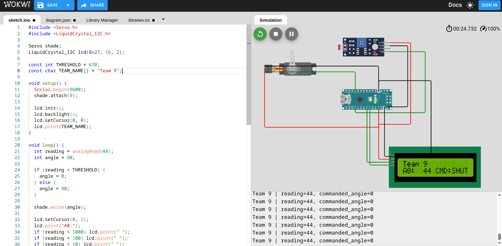

# Lab 3 – THINK + ACT: Sense → Process → Act

- **Team name:** Team 9
- **Prototype or display label:** Automatic Window Shade (`Team 9`)
- **Members' GitHub usernames:** caocchinh, DUCDUCDUC38, bfhvn, phamvuminh080908
- **Shared Wokwi project link:** https://wokwi.com/projects/481679833393944577

## 1. Explore the Nano, program and connections

### 1.1. Explore the Nano board — Activity 1

Record your team's discussion in one or two sentences per question.

1. In **Processor and memory**, identify the chip that runs your sketch. Which memory keeps the program when power is removed, and which memory loses its working data?
   - **Answer:** The ATmega328P runs the sketch. Flash stores the program (and EEPROM retains saved data without power), while SRAM loses its working data when power is off.

2. In **Clock speed**, compare 16 MHz with the example laptop clock. Why does the frequency ratio alone not tell you how much faster a program will run?
   - **Answer:** 2.4 GHz is 150× the clock frequency, but architecture, cores, memory, and waiting time also affect speed.

3. In **Analogue pins**, **Digital pins** and **Power and ground**, locate A0, D9, 5V and GND. Which connections carry information, and which provide power or a reference voltage?
   - **Answer:** A0 and D9 carry information. 5V supplies power and GND is the common reference.

4. In **Built-in LED**, find D13 and try the control. Could A6 replace D13 as an output? Use the pin descriptions to explain your answer.
   - **Answer:** No. A6 is analogue-input only, so it cannot act as a digital output.

5. Imagine building a smart light that turns on automatically when a room gets dark. Which Arduino pins could you use to connect a light sensor and an LED? What would the Arduino program need to decide?
   - **Answer:** Connect the sensor's AO to A0, because A0 can measure a changing voltage, and connect the LED to a digital pin such as D13. The program checks whether the reading rises above a darkness threshold: if so, the LED turns on, and otherwise it stays off.

6. Imagine building an automatic window shade that closes when sunlight is too bright. How could you use readings from a light sensor to decide when to close the shade? What could you connect to the Arduino to physically move the shade?
   - **Answer:** Close the shade when the reading passes a brightness threshold. A servo on D9 moves the shade.

### 1.2. Trace the program — Activity 2

In one sentence, describe what happened to the startup and loop messages when you ran and restarted the Activity 2 program.

- **Answer:** When the program started, `setup()` ran once to print `Ready` and `loop()` repeated to increment `count` and print `Loop 1`, `Loop 2`, `Loop 3`, ..., and after changing both `delay(500)` calls to `delay(1000)` and restarting, `setup()` ran once again to print `Ready`, `count` reset to `0` so the loop messages restarted at `Loop 1`, and the built-in LED flashed at half the rate (1000 ms on and 1000 ms off instead of 500 ms) because the longer software delays paused execution longer even though the processor still ran at 16 MHz.

### 1.3. Explain the connections — Activities 3 and 4

Use one or two sentences for each explanation. Include a labelled sensor → controller → actuator chain; text is sufficient. Include the LCD as an additional output.

- **System chain:** LDR light sensor module (sensor, `AO -> A0`) -> Arduino Nano (controller) -> Servo motor (actuator, `D9`) + I2C LCD 1602 at `0x27` (additional output, `SDA -> A4`, `SCL -> A5`).

- **Why must the sensor, servo and Nano share GND?**
  - **Answer:** They share GND to establish 0 V as a common voltage reference and current return path. The Nano measures the sensor's analogue voltage on A0 relative to GND, and the servo reads the Nano's 5 V PWM control pulses on D9 relative to that same 0 V reference.

- **Why does AO connect to an analogue input, and what would change in the code if you used A1 instead of A0?**
  - **Answer:** AO connects to an analogue input because the sensor outputs a voltage that varies with light, and the Nano's ADC measures that voltage. If you wire AO to A1, replace `analogRead(A0)` with `analogRead(A1)`.

- **What does D9 carry, which wires supply the servo's power, and what would change if the signal moved to D8?**
  - **Answer:** D9 carries the servo control pulses, V+ connects to 5 V, and GND provides the return path. If you move the signal wire to D8, change `shade.attach(9)` to `shade.attach(8)`.

## 2. Observe the sensor

Record two live input conditions before implementing the decision. The light setting is in lux; the sensor reading is the whole number returned by `analogRead(A0)`, from 0 to 1023.

| Condition  | Simulated light setting (lux) | Observed sensor reading (0–1023) |
| ---------- | ----------------------------- | -------------------------------- |
| Less light | 0.1                           | 1015                             |
| More light | 100000                        | 8                                |

Explain how the reading changes with light. Why does the 10-bit ADC return 0–1023 even though the Nano stores the result in a 16-bit `int`?

- **How the reading changes:** More light lowers the sensor's output voltage, so the reading dropped from 1015 at 0.1 lux to 8 at 100000 lux.
- **10-bit ADC vs. 16-bit `int`:** The 10-bit ADC produces 1,024 possible values, from 0 to 1023. The 16-bit `int` stores the result without changing the ADC's resolution.

## 3. State the requirement

- **Threshold T (sensor reading):** `670`
- **Closed command (degrees):** `0°`
- **Open command (degrees):** `90°`

State the rule, including what happens at equality, and justify the threshold using your observations. Keep T between 1 and 1022.

- **Decision rule:** If `reading < 670` (brighter than the threshold), command the servo to `0°` (closed). If `reading >= 670`, including at equality (`reading == 670`), command the servo to `90°` (open).
- **Justification:** From Section 2, the sensor reading drops as light increases, ranging from `1015` at `0.1 lux` (less light) to `8` at `100000 lux` (more light). Setting `T = 670` (within `1–1022`) sits well between the two observed extremes so bright light reliably triggers the closed state (`< 670`) while dimmer conditions keep the shade open (`>= 670`).

## 4. Test and revise

Write predictions before running the tests. Record actual results separately and state whether each agrees. Mark an unexecuted test as “Not run.”

Complete the first three rows in Activity 5, before adding the LCD; record its state as “Not added.” Restore `int reading = analogRead(A0);`, then add the LCD and complete the two live-test rows in Activity 6.

| Test              | Input value and source                                   | Expected command and response                                                      | Observed command, virtual response and LCD state                                                                                           | Agreement or correction |
| ----------------- | -------------------------------------------------------- | ---------------------------------------------------------------------------------- | ------------------------------------------------------------------------------------------------------------------------------------------ | ----------------------- |
| Below threshold   | `669` (T − 1), injected software input                   | `reading=669, commanded_angle=0`, servo moves to `0°`                              | `reading=669, commanded_angle=0`, servo moved to `0°`, LCD: Not added                                                                      | Agreed                  |
| At threshold      | `670` (T), injected software input                       | `reading=670, commanded_angle=90`, servo moves to `90°`                            | `reading=670, commanded_angle=90`, servo moved to `90°`, LCD: Not added                                                                    | Agreed                  |
| Above threshold   | `671` (T + 1), injected software input                   | `reading=671, commanded_angle=90`, servo stays at `90°`                            | `reading=671, commanded_angle=90`, servo stayed at `90°`, LCD: Not added                                                                   | Agreed                  |
| Bright live input | `8318 lux` (observed count: `44`), live simulated sensor | `reading < 670`, `commanded_angle=0`, servo moves to `0°`, LCD shows `CMD:SHUT`    | `Team 9 \| reading=44, commanded_angle=0`, servo moved to `0°`, LCD showed `Team 9` / `A0: 44 CMD:SHUT` (agreed with serial and servo)     | Agreed                  |
| Live recovery     | `3 lux` (observed count: `944`), live simulated sensor   | `reading >= 670`, `commanded_angle=90`, servo moves to `90°`, LCD shows `CMD:OPEN` | `Team 9 \| reading=944, commanded_angle=90`, servo moved to `90°`, LCD showed `Team 9` / `A0: 944 CMD:OPEN` (agreed with serial and servo) | Agreed                  |

Explain one correction or limitation. Distinguish the injected tests from tests using the simulated sensor.

- **Limitation:** The Wokwi simulation confirms wiring and decision logic, but it does not verify physical constraints such as servo torque, power-supply current capacity, or real mechanical movement. Moving the virtual servo does not reduce the simulated light reaching the LDR.
- **Injected vs. simulated-sensor tests:** The injected tests (`669`, `670`, `671`) replace `analogRead(A0)` with fixed values in code and bypass the LDR, isolating and verifying the exact `if`/`else` boundary behavior at `T = 670`. The live simulated-sensor tests restore `analogRead(A0)` and move the LDR lux slider across the threshold in both directions, testing the full sensor -> ADC -> controller -> servo and I2C LCD chain.

In the two live-test rows, record whether the LCD reading and command agree with the serial output and servo response. Use the handout’s [I2C explanation and connection table](https://vinuni-cecs1011.github.io/labs/lab-03.html#lcd-interface) to check the display wiring and address.

_Figure 1. Live bright-input test at `8318 lux` (`reading=44 < 670`): the serial monitor reports `Team 9 | reading=44, commanded_angle=0`, the I2C LCD (`0x27`) displays `Team 9` and `A0: 44 CMD:SHUT`, and the servo on D9 moves to `0°` (closed)._

## 5. Connect to the final project

In two or three sentences, describe an input → decision → output chain useful for your final project. State how the sensor and output connect to the controller, and name one physical test. Use the handout’s [project examples](https://vinuni-cecs1011.github.io/labs/lab-03.html#project-examples) for guidance. Your Lab 2 mount or enclosure may support this design.

- **Answer:** For our Smart Fridge Freshness Monitor, the chain is temperature, humidity, and gas readings -> detect spoilage risk or door-open spikes -> send a mobile push alert. The temp/humidity sensor connects via I2C (SDA/SCL) and the gas sensor connects to A0 with shared power and GND, while the MCU's wireless radio outputs packets to the backend. Mounted in our Lab 2 PETG holder, one physical test is leaving the fridge door ajar to check that the wireless signal passes through the fridge wall and sends the alert.

## Source files

- [Controller program](sketch.ino).
- [Circuit diagram](diagram.json).
- [Library list](libraries.txt).

## Contributions

Use one row per member. Each member should commit meaningful work using their own GitHub account and explain their practice or team contribution. Prediction, coding, testing, interpretation, paired work and documentation all count when supported by evidence.

| GitHub username  | Contribution and related evidence                                                                                                                                                                                | One result or concept I can explain                                                                                                                          |
| ---------------- | ---------------------------------------------------------------------------------------------------------------------------------------------------------------------------------------------------------------- | ------------------------------------------------------------------------------------------------------------------------------------------------------------ |
| caocchinh        | Built and exported the Wokwi controller (`sketch.ino`, `diagram.json`, `libraries.txt`), ran the boundary (`669`/`670`/`671`) and live tests with `controller.png`, and updated Sections 4 and 5 in `README.md`. | I can explain how `reading < 670` (and equality at `670`) drives the servo on D9 and I2C LCD (`0x27`), and how injected tests differ from live sensor tests. |
| DUCDUCDUC38 | Completed Section 1 of README.md and created the shared Wokwi project for Team 9’s Automatic Window Shade. Evidence: Section 1 and the Wokwi link in the report. | I explain how the Nano measures the light sensor’s voltage on A0, sends servo control pulses on D9, and uses GND as the common voltage reference. |                                                                                                                                                     |
| bfhvn | Verified the Wokwi circuit wiring (`A0`, `D9`, I2C `0x27`), cross-checked predicted vs. observed test outputs in Section 4, and reviewed `README.md` formatting and AI verification notes. | I can explain how the I2C LCD (`SDA`/`SCL`) and serial monitor confirm synchronized sensor readings (`A0`) and servo commands (`CMD:SHUT` vs. `CMD:OPEN`). |
| phamvuminh080908 | Recorded and analysed the LDR sensor readings under different light conditions, then determined the threshold (T = 670) and defined the servo's open/close decision rules. Evidence: Sections 2 and 3 in README.md. | I can explain how light intensity affects the analogue sensor readings and how the threshold determines whether the window shade opens or closes. |                                                                                                                                                                                                                  |                                                                                                                                                              |

## Sources and AI use

- **Sources:** Supplied Lab 3 handout and checkpoints, Arduino Nano documentation, and our Lab 2 report and project specification.
- **AI use:** We used Gemini Neon to clean up Markdown formatting, check our answers against the Lab 3 handout, and tighten wording in `README.md` based on our own Wokwi code, measurements, and project spec.
- **Verification and corrections:** All Wokwi wiring, boundary/live tests, and exported files (`sketch.ino`, `diagram.json`, `libraries.txt`, `controller.png`) were run and verified by the team. We also caught and corrected AI errors, including removing observed counts (`44` and `944`) that AI placed in the live-test prediction column and revising Section 5 after AI suggested a buzzer that is not in our actual fridge monitor design.

Before submission, check this record against the handout supplied for Lab 3. Submit your team name, ordinary repository URL, report path, latest full `main` SHA and shared Wokwi project link in Canvas after all files are saved. Keep the SHA out of this report.
